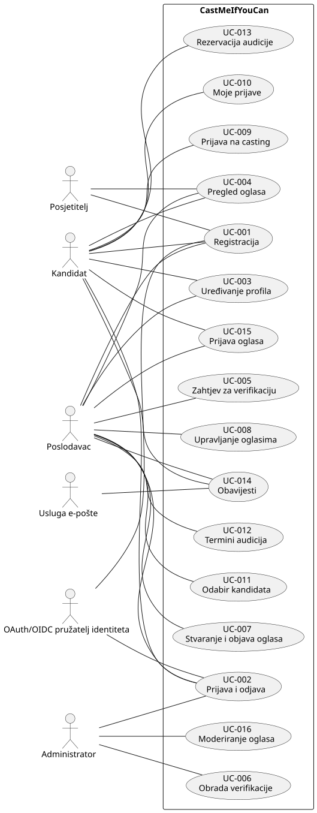

# 3. Obrasci uporabe — CastMeIfYouCan

Verzija: Priprema za M0 (4. tjedan), listopad 2026.

U ovom dijelu opisujemo kako će se koristiti naša aplikacija: tko što radi, koji su koraci i što se događa ako nešto ne uspije. Koristimo iste oznake funkcijskih zahtjeva kao u Analizi zahtjeva. Ovo je planirano ponašanje aplikacije — ne znači da su sve funkcije već gotove.

Za UC-001 i UC-002 implementirani su auth API i odvojene automatizirane HTTP/DB provjere. [Autentifikacija](AUTENTIFIKACIJA.md) opisuje stvarni ugovor, a [Ispitivanje](5-Ispitivanje.md) razlikuje automatizirane testove od stvarnog lokalnog kandidatskog toka potvrđenog u [Google prijavi](GOOGLE_PRIJAVA.md). Stvarni poslodavački tok i produkcija nisu potvrđeni. UC-003 još ima preostalu demonstracijsku lokalnu pohranu.

## 3.1 Dijagram obrazaca uporabe

Na dijagramu je prikazano tko koristi CastMeIfYouCan i koje su glavne radnje dostupne pojedinim korisnicima.

Glavni akteri: Posjetitelj (A-01), kandidat (A-02), poslodavac (A-03) i administrator (A-04). Usluga e-pošte (A-05) planirana je za obavijesti, a OAuth/OIDC pružatelj identiteta (A-06) sudjeluje u registraciji i prijavi. Implementirani pružatelj identiteta je Google; usluga e-pošte nije potvrđena ovim auth pregledom.

Slika 3.1. Dijagram obrazaca uporabe — CastMeIfYouCan

PlantUML izvor: [3-1-castmeifyoucan-system-UC.puml](puml/3-1-castmeifyoucan-system-UC.puml). Za sliku smo upotrijebili PlantUML prikaz dijagrama koji smo odabrali za projekt.

Dijagram prikazuje 16 glavnih obrazaca uporabe: registraciju i prijavu, profile, oglase, prijave kandidata, audicije, obavijesti, verifikaciju i administraciju. Neke manje radnje nalaze se unutar tih obrazaca, zato ne crtamo poseban oval za svaku funkciju iz dokumenta 2.

Prijava: Dogovorili smo da koristimo OAuth 2.0 / OpenID Connect. Vanjski pružatelj provjerava identitet, a CastMeIfYouCan zatim povezuje korisnika s ulogom kandidata, poslodavca ili administratora. Nećemo izrađivati vlastiti sustav lozinki.

## 3.2 Specifikacije obrazaca uporabe

Za svaki obrazac uporabe napisali smo tko ga pokreće, što treba biti ispunjeno, glavni tijek, važne iznimke i rezultat. Tekst je namjerno kratak i prati korisničke radnje, a tehnički detalji pripadaju implementaciji.

### UC-001: Registracija

Obrazac pokreće Posjetitelj (A-01).

Povezani zahtjevi su F-001.

Prije početka vrijedi sljedeće: Korisnik još nema povezan profil u aplikaciji. Za prijavu koristi vanjskog OAuth/OIDC pružatelja identiteta.

Korisnik odabire registraciju. Aplikacija ga preusmjerava na vanjskog pružatelja identiteta. Korisnik uspješno potvrđuje identitet i vraća se u aplikaciju. Odabire ulogu kandidata ili poslodavca i unosi potrebne podatke profila odnosno tvrtke. Aplikacija provjerava podatke i sprema račun povezan s vanjskim identitetom. Prikazuje se potvrda.

Mogući su i sljedeći ishodi: 3a – Korisnik odustane ili vanjska prijava ne uspije: račun se ne stvara. 4a – Nedostaju podaci: korisnik ih mora dopuniti. 5a – Kandidat nema 18 godina: registracija se odbija. 5b – Neispravan OIB poslodavca: potrebno je ispraviti unos. 5c – Vanjski identitet već je povezan s računom: aplikacija ne stvara duplikat.

Ishod uporabe: Korisnik ima profil povezan s vanjskom prijavom. Poslodavac mora proći verifikaciju prije objavljivanja oglasa.

### UC-002: Prijava i odjava

Obrazac pokreće Kandidat (A-02), poslodavac (A-03), administrator (A-04).

Povezani zahtjevi su F-002, F-003.

Prije početka vrijedi sljedeće: Korisnik ima račun povezan s vanjskim identitetom ili dodijeljen administratorski pristup.

Korisnik odabire Prijava. Aplikacija ga preusmjerava na OAuth/OIDC pružatelja identiteta. Korisnik se uspješno prijavi kod pružatelja i vraća u aplikaciju. Aplikacija prepoznaje povezani vanjski identitet i otvara postojeći korisnički profil i sesiju s odgovarajućom ulogom, bez stvaranja novog računa. Kad završi, korisnik odabire Odjava i aplikacija završava njegovu sesiju.

Mogući su i sljedeći ishodi: 3a – Korisnik odustane ili prijava ne uspije: aplikacija ne otvara sesiju. 4a – Nevaljan odgovor pružatelja: prijava se odbija. 4c – Identitet nije povezan s računom: aplikacija vodi korisnika na dovršetak registracije i ne daje mu pristup tuđem profilu. 4b – Korisnik još nema dovršen profil: aplikacija ga vodi na dovršetak registracije. 5a – Nakon odjave: zaštićene funkcije više nisu dostupne.

Ishod uporabe: Korisnik se prijavio preko vanjskog pružatelja i koristi funkcije svoje uloge ili se uspješno odjavio.

### UC-003: Uređivanje profila

Obrazac pokreće Kandidat (A-02), poslodavac (A-03).

Povezani zahtjevi su F-004, F-005.

Prije početka vrijedi sljedeće: Korisnik je prijavljen.

Korisnik otvara svoj profil. Aplikacija prikazuje postojeće podatke. Kandidat mijenja podatke, iskustvo, vještine ili fotografije; poslodavac uređuje podatke tvrtke. Korisnik odabire spremanje. Aplikacija provjerava unos i sprema promjene.

Mogući su i sljedeći ishodi: 3a – Previše fotografija: kandidat ne može spremiti više od pet fotografija u portfoliju. 3b – Pogrešan format slike: dopušteni su JPG i PNG. 5a – Neispravni podaci: aplikacija prikazuje poruku i ne sprema promjene. Lozinkom i vanjskim računom korisnik upravlja kod svog pružatelja identiteta.

Ishod uporabe: Promjene su spremljene i vide se nakon ponovne prijave; tuđi profil ne može se uređivati.

### UC-004: Pregled oglasa

Obrazac pokreće Posjetitelj (A-01); pregled je dostupan i prijavljenim korisnicima.

Povezani zahtjevi su F-008.

Prije početka vrijedi sljedeće: Aplikacija je dostupna.

Korisnik otvara početnu stranicu. Aplikacija prikazuje javno objavljene oglase. Korisnik može upisati pretragu ili odabrati filtre. Odabire zanimljiv oglas. Aplikacija prikazuje opis projekta i uloge, uvjete, lokaciju i rok.

Mogući su i sljedeći ishodi: 3a – Nema rezultata: prikazuje se poruka da nema odgovarajućih oglasa. 4a – Oglas ne postoji ili nije javno dostupan: prikazuje se odgovarajuća poruka.

Ishod uporabe: Korisnik je pronašao i pregledao oglas, bez potrebe za prijavom.

### UC-005: Zahtjev za verifikaciju

Obrazac pokreće Poslodavac (A-03).

Povezani zahtjevi su F-006.

Prije početka vrijedi sljedeće: Poslodavac je registriran i prijavljen.

Poslodavac otvara profil tvrtke. Unosi potrebne podatke. Odabire slanje zahtjeva za verifikaciju. Aplikacija provjerava podatke. Zahtjev se sprema sa statusom na čekanju.

Mogući su i sljedeći ishodi: 4a – Nepotpuni podaci: aplikacija traži dopunu. 3a – Zahtjev je već na čekanju: prikazuje se postojeći status. 3b – Prethodni zahtjev je odbijen: poslodavac vidi razlog i može poslati novi zahtjev.

Ishod uporabe: Zahtjev za verifikaciju čeka odluku administratora.

### UC-006: Obrada verifikacije

Obrazac pokreće Administrator (A-04).

Povezani zahtjevi su F-007.

Prije početka vrijedi sljedeće: Administrator je prijavljen i postoji zahtjev za verifikaciju.

Administrator otvara popis zahtjeva. Odabire zahtjev i pregledava podatke tvrtke. Odobrava ili odbija zahtjev. Aplikacija sprema odluku i mijenja status.

Mogući su i sljedeći ishodi: 3a – Odbijanje: administrator mora navesti razlog. 3b – Odustajanje: zahtjev ostaje nepromijenjen. 4a – Korisnik nema ovlasti: aplikacija odbija radnju.

Ishod uporabe: Poslodavac vidi novi status; nakon odobrenja može objavljivati oglase.

### UC-007: Stvaranje i objava oglasa

Obrazac pokreće Poslodavac (A-03).

Povezani zahtjevi su F-012.

Prije početka vrijedi sljedeće: Poslodavac je prijavljen. Za javnu objavu treba biti verificiran.

Poslodavac otvara obrazac Novi oglas. Unosi naziv i tip projekta, opis, ulogu, lokaciju i rok prijave. Posebno upisuje broj traženih kandidata i maksimalan broj prijava (zadano 1000). Odabire Objavi. Aplikacija provjerava podatke i verifikaciju. Oglas se sprema kao objavljen.

Mogući su i sljedeći ishodi: 4a – Spremi nacrt: oglas se sprema bez javne objave; nacrt može spremiti i neverificirani poslodavac. 5a – Poslodavac nije verificiran: objava se odbija. 5b – Nedostaju podaci ili rok nije u budućnosti: traži se ispravak. 5c – Broj kandidata ili limit prijava nije ispravan: objava se odbija.

Ishod uporabe: Oglas je javno objavljen ili spremljen kao nacrt. Prema našem dogovoru jedan oglas predstavlja jedan projekt i jednu ulogu.

### UC-008: Upravljanje oglasima

Obrazac pokreće Poslodavac (A-03).

Povezani zahtjevi su F-013, F-014.

Prije početka vrijedi sljedeće: Poslodavac je prijavljen i ima barem jedan oglas.

Poslodavac otvara Moji oglasi. Aplikacija prikazuje samo njegove oglase. Može ih pretraživati i filtrirati prema statusu. Odabire svoj oglas i mijenja dopuštene podatke. Sprema promjene.

Mogući su i sljedeći ishodi: 4a – Zatvori prijave: nakon potvrde oglas više ne prima prijave. 4b – Otkaži oglas: nakon potvrde mijenja se status i obrađuju se buduće audicije. 4c – Pokušaj uređivanja tuđeg oglasa: radnja se odbija. 5a – Nedopuštena promjena: aplikacija prikazuje poruku i ne sprema izmjenu.

Ishod uporabe: Oglas je ažuriran ili mu je promijenjen status prema pravilima.

### UC-009: Prijava na casting

Obrazac pokreće Kandidat (A-02).

Povezani zahtjevi su F-009.

Prije početka vrijedi sljedeće: Kandidat je prijavljen; oglas je objavljen i još prima prijave.

Kandidat otvara željeni oglas. Odabire prijavu na casting. Ispunjava obrazac i potvrđuje prijavu. Aplikacija provjerava rok, status oglasa, limit i postojeće prijave. Prijava se sprema i prikazuje se potvrda.

Mogući su i sljedeći ishodi: 2a – Korisnik nije prijavljen: preusmjerava se na prijavu u sustav. 4a – Kandidat se već prijavio: nova prijava se odbija. 4b – Rok je istekao ili su prijave zatvorene: prijava se odbija. 4c – Dosegnut maksimalan broj prijava ili je oglas popunjen/otkazan: prijava se odbija. 5a – Greška spremanja: nema lažne potvrde.

Ishod uporabe: Prijava je spremljena i dostupna kandidatu u Mojim prijavama.

### UC-010: Moje prijave

Obrazac pokreće Kandidat (A-02).

Povezani zahtjevi su F-010.

Prije početka vrijedi sljedeće: Kandidat je prijavljen.

Kandidat otvara Moje prijave. Aplikacija prikazuje njegove prijave i statuse. Kandidat odabire prijavu. Pregledava detalje oglasa i status.

Mogući su i sljedeći ishodi: 2a – Nema prijava: prikazuje se poruka da zasad nema prijava. 3a – Kandidat želi povući prijavu: potvrđuje povlačenje; aplikacija ga dopušta samo ako pravila to dozvoljavaju. 3b – Pokušaj pregleda tuđe prijave: pristup se odbija.

Ishod uporabe: Kandidat je pregledao prijave ili povukao dopuštenu prijavu.

### UC-011: Odabir kandidata

Obrazac pokreće Poslodavac (A-03).

Povezani zahtjevi su F-015, F-020.

Prije početka vrijedi sljedeće: Poslodavac je prijavljen i na njegov oglas stigle su prijave.

Poslodavac otvara vlastiti oglas i popis prijava. Pregledava dopuštene podatke prijavljenih kandidata. Po potrebi mijenja status (u pregledu, uži izbor, poziv na audiciju). Nakon procesa odabira označava kandidata odabranim ili odbijenim. Aplikacija sprema odluku i ažurira status.

Mogući su i sljedeći ishodi: 1a – Nema prijava: prikazuje se poruka. 4a – Kandidat je odbijen: poslodavac unosi razlog. 5a – Odabran je traženi broj kandidata: oglas postaje popunjen i zatvara se za nove prijave. 5b – Nedopušten prijelaz statusa ili previše odabranih: radnja se odbija. 1b – Tuđi oglas: pristup prijavama se odbija.

Ishod uporabe: Statusi prijava su ažurirani, a odabir se sprema bez prekoračenja broja traženih kandidata.

### UC-012: Termini audicija

Obrazac pokreće Poslodavac (A-03).

Povezani zahtjevi su F-017, F-019.

Prije početka vrijedi sljedeće: Poslodavac je prijavljen i ima oglas za koji organizira audicije.

Poslodavac otvara audicije svojeg oglasa. Odabire dodavanje termina. Unosi datum, početak, završetak, lokaciju i broj mjesta. Aplikacija provjerava podatke. Termin se sprema i dostupan je pozvanim kandidatima.

Mogući su i sljedeći ishodi: 4a – Pogrešno vrijeme ili kapacitet: termin se ne sprema. 2a – Otkazivanje termina: poslodavac otkazuje termin i rezervirani kandidati dobivaju obavijest. 5a – Nakon audicije: poslodavac može evidentirati dolazak ili nedolazak.

Ishod uporabe: Termin je spremljen ili otkazan; status dolaska evidentira se kada je potrebno.

### UC-013: Rezervacija audicije

Obrazac pokreće Kandidat (A-02).

Povezani zahtjevi su F-018.

Prije početka vrijedi sljedeće: Kandidat je prijavljen i pozvan je na audiciju.

Kandidat otvara poziv na audiciju. Aplikacija prikazuje slobodne termine. Kandidat odabire termin. Aplikacija provjerava ima li mjesta i smije li kandidat rezervirati. Rezervacija se sprema i kandidat dobiva potvrdu.

Mogući su i sljedeći ishodi: 2a – Nema mjesta: prikazuje se poruka. 4a – Mjesto se upravo popunilo: rezervacija se odbija i kandidat može odabrati drugi termin. 4b – Kandidat nije pozvan ili već ima aktivnu rezervaciju: nova rezervacija se odbija. 5a – Promjena/otkazivanje: kandidat oslobađa mjesto i po pravilima bira drugi termin.

Ishod uporabe: Kandidat ima potvrđenu rezervaciju ili je uspješno otkazao odnosno promijenio prethodnu.

### UC-014: Obavijesti

Obrazac pokreće Kandidat (A-02), poslodavac (A-03); usluga e-pošte (A-05) je sekundarni akter.

Povezani zahtjevi su F-011, F-023.

Prije početka vrijedi sljedeće: Korisnik ima račun; nastao je događaj važan za njegovu prijavu ili audiciju.

Nakon promjene sustav stvara obavijest za odgovarajućeg korisnika. Korisnik otvara Obavijesti. Aplikacija prikazuje poruku i datum. Korisnik je može označiti pročitanom.

Mogući su i sljedeći ishodi: 2a – Nema obavijesti: prikazuje se odgovarajuća poruka. 1a – Važna promjena: ako je dogovorena vanjska usluga, pokušava se poslati i e-mail. 1b – Slanje e-pošte nije uspjelo: greška se bilježi, bez prikazivanja lažne potvrde dostave.

Ishod uporabe: Korisnik vidi obavijest i po potrebi mijenja njezin status u pročitano. E-pošta je još planirana integracija.

### UC-015: Prijava oglasa

Obrazac pokreće Kandidat (A-02), poslodavac (A-03).

Povezani zahtjevi su F-021.

Prije početka vrijedi sljedeće: Korisnik je prijavljen i može pregledati oglas.

Korisnik otvara oglas s neprimjerenim sadržajem. Odabire opciju Prijavi oglas. Unosi razlog prijave. Potvrđuje slanje. Aplikacija sprema prijavu za administratora.

Mogući su i sljedeći ishodi: 3a – Nema razloga: aplikacija traži unos razloga. 4a – Korisnik odustaje: prijava se ne sprema. 5a – Problem sa spremanjem: prikazuje se greška.

Ishod uporabe: Administrator može pregledati prijavu; samim slanjem oglas se ne briše.

### UC-016: Moderiranje oglasa

Obrazac pokreće Administrator (A-04).

Povezani zahtjevi su F-016.

Prije početka vrijedi sljedeće: Administrator je prijavljen i postoji oglas ili prijava sadržaja za pregled.

Administrator otvara popis prijavljenih oglasa. Pregledava prijavu, razlog i oglas. Odlučuje hoće li prijavu odbiti ili poduzeti moderatorsku radnju. Aplikacija provjerava ovlasti i sprema odluku.

Mogući su i sljedeći ishodi: 3a – Trajno brisanje oglasa: administrator mora potvrditi brisanje; uklanjaju se oglas i dogovoreni povezani zapisi i datoteke. 3b – Prijava nije opravdana: zatvara se bez brisanja oglasa. 3c – Administrator odustaje: oglas ostaje nepromijenjen. 4a – Neovlašten korisnik: radnja se odbija.

Ishod uporabe: Prijava je obrađena. Kod potvrđenog brisanja oglas i povezani podaci više nisu dostupni.

## 3.3 Provjera dosljednosti obrazaca uporabe

Usporedili smo obrasce s ulogama i funkcijskim zahtjevima iz Analize zahtjeva.

Povezanost sa zahtjevima. Svaki opisani UC navodi postojeće oznake F-001 do F-015 iz dokumenta 2.

Korisničke uloge. Provjerit ćemo da kandidat ne može uređivati tuđe oglase, poslodavac ne vidi tuđe prijave i samo administrator izvršava administrativne radnje.

Glavni tijek. Svaki opisani postupak treba imati jasan početak, korake i rezultat.

Alternativni tijekovi. Obrađujemo važne slučajeve: krive podatke, istek roka, duple prijave, popunjene termine i radnje bez ovlasti.

Usklađenost s implementacijom. Tijekom razvoja provjeravat ćemo odgovara li stvarni rad aplikacije ovim opisima.

Testiranje. Auth/DB testovi i potvrđeni kandidatski Google scenariji povezani su u [Ispitivanju](5-Ispitivanje.md). Rezultati ostalih obrazaca dodaju se nakon njihova izvođenja.

Zahtjevi koje nismo izdvojili u zaseban oval: F-002 (ponovna prijava preko istog vanjskog identiteta bez stvaranja duplog profila) obuhvaćen je u [UC-002](#uc-002-prijava-i-odjava). F-022 (administratorska statistika) jednostavan je prikaz opisan u [Analizi zahtjeva](2-Analiza-zahtjeva.md#f-022). Sljedivost zahtjeva i testova vodi se u [Analizi zahtjeva](2-Analiza-zahtjeva.md#26-sljedivost-zahtjeva).

Pitanja evidentirana pri pripremi M0:

Kojeg OAuth/OIDC pružatelja identiteta ćemo koristiti? Naknadno je odabran i implementiran Google; lokalni kandidatski tok potvrđen je u [PR-u #44](https://github.com/paolabbradaric/grupa122/pull/44).

Koju vanjsku uslugu ćemo koristiti za e-poštu i je li ona dovoljna kao vanjska integracija?

Tko točno smije trajno brisati oglase i koje sve povezane podatke brišemo?

Koje podatke kandidata smije vidjeti poslodavac?

Koji su točni dopušteni prijelazi statusa oglasa, prijava i rezervacija?

Zaključak: Opisali smo 16 važnih obrazaca uporabe aplikacije CastMeIfYouCan. Oni nam služe kao plan za daljnji razvoj i testiranje, a ažurirat ćemo ih kada potvrdimo otvorene dogovore i povežemo sve dijelove sustava.
