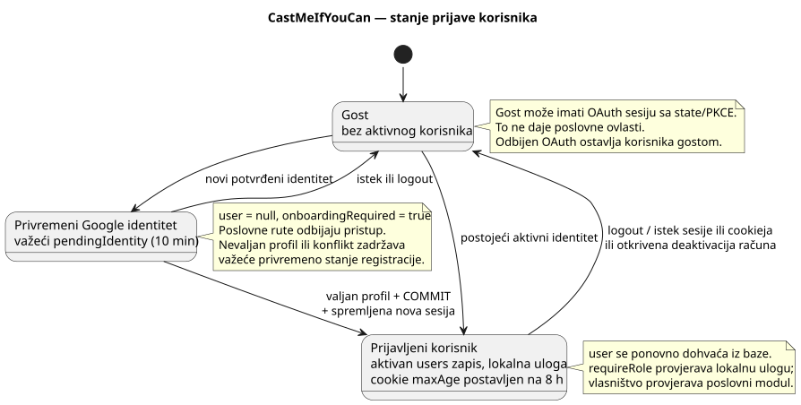

# 4. Arhitektura i oblikovanje — CastMeIfYouCan

Aplikacija koristi React/Vite klijent i Node.js/Express backend s PostgreSQL bazom podataka. Google služi kao pružatelj identiteta, a javna aplikacija postavljena je putem Vercela. Auth, oglasi, prijave kandidata, audicije, obavijesti i administracija organizirani su u odvojene module unutar istog backenda. Dodatni tehnički detalji i provjere navedeni su u [Autentifikaciji](AUTENTIFIKACIJA.md), [Bazi podataka](BAZA_PODATAKA.md) i [Ispitivanju](5-Ispitivanje.md).

## 4.1 Ključne arhitekturne odluke

Zadržan je postojeći Express backend i CommonJS način organizacije koda. Pristup prijavi iz ranijeg NestJS projekta prilagođen je postojećim modulima i pg poolu. Time je autentifikacija dodana bez promjene ostatka aplikacijskog okvira.

Korisnički račun povezuje se s Googleovim trajnim identifikatorom preko `users.auth_id = google:`. Podudaranje e-mail adrese ne povezuje automatski dva različita identiteta. Google potvrđuje identitet, a lokalna baza određuje korisnikovu ulogu i je li račun aktivan.

Sadržaj sesije sprema se u PostgreSQL kako bi se mogao ponovno učitati nakon restarta procesa. Korisnik i njegov profil ili organizacija nastaju u jednoj transakciji, dok je spremanje prijavljene sesije zaseban korak nakon uspješnog upisa računa.

Pravila za nepotpune nacrte provode se i u bazi. Ona odbija nepotpunu objavu čak i pri izravnom SQL upisu. Backend dodatno provjerava vlasništvo oglasa, verifikaciju poslodavca i dopuštene promjene statusa.

React klijent prikazuje javne oglase i zasebna sučelja kandidata, poslodavca i administratora. Zaštićeni API zahtjevi prolaze autentifikaciju i provjere uloge, vlasništva i CSRF tokena; poslovni moduli provode dodatna pravila o rokovima, statusima, limitima prijava i kapacitetima termina. Kandidatove prijave i obavijesti dohvaćaju se putem API-ja, a rezerviranje audicija povezuje kandidatov prikaz s postojećim backend rutama ([PR #66](https://github.com/paolabbradaric/grupa122/pull/66), [PR #68](https://github.com/paolabbradaric/grupa122/pull/68)).

## 4.2 Gradivni blokovi i UML dijagram komponenata

Izvor dijagrama nalazi se u [mario-arhitektura.puml](puml/mario-arhitektura.puml).

React klijent prikazuje prijavu i registraciju te prilagođava navigaciju ulozi dobivenoj s poslužitelja. To je povezano kroz [App.jsx](../frontend/src/App.jsx) i [useAuth.js](../frontend/src/services/useAuth.js).

Auth [rute](../backend/src/auth/routes.js) obrađuju Google prijavu, dovršavanje registracije, dohvat korisnika i odjavu. [Passport](../backend/src/auth/passport.js) povezuje Google identitet s lokalnim računom i ponovno učitava korisnika iz sesije. Sesijski middleware uključen je u [app.js](../backend/src/app.js).

[Validacija](../backend/src/auth/validation.js) provjerava podatke registracije, a [korisnički model](../backend/src/auth/userModel.js) izvršava parametrizirane upite i transakcije. Zajedničke provjere prijave, uloge, Origina i CSRF tokena nalaze se u [middleware.js](../backend/src/auth/middleware.js). Vlasništvo pojedinog zapisa provjerava odgovarajući poslovni modul.

PostgreSQL čuva domenske podatke i privatne sesije prema [SQL shemi](../db/schema.sql). Backend pristupa bazi preko TLS veze konfigurirane u [db.js](../backend/src/config/db.js). Supabase ovdje pruža bazu, dok je Google vanjski pružatelj identiteta. Googleovi pristupni tokeni ne spremaju se za kasniju uporabu.

## 4.3 Model podataka i oblikovanje razreda

### 4.3.1 ER dijagram i model podataka

PlantUML: [mario-model-podataka.puml](puml/mario-model-podataka.puml). Implementacija: [schema.sql](../db/schema.sql). Objašnjenje tablica, ograničenja i nadogradnji: [Baza podataka](BAZA_PODATAKA.md).

Temeljni dio sheme povezuje korisnike, kandidatove profile i organizacije, projekte i oglase, prijave, termine audicija i rezervacije. Dodatne tablice služe vještinama, povezanim datotekama, povijesti statusa, privatnim sesijama, profilnim medijima, prijavama neprimjerenih oglasa, evidenciji moderacije i ograničenjima predaje prijava. Potpuni aktualni popis tablica i ograničenja nalazi se u [schema.sql](../db/schema.sql), uz migracije za postojeće baze.

Dijagram prikazuje temeljne kardinalnosti: korisnik ima najviše jedan kandidatov profil; vlasnik može imati više organizacija; projekt ima najviše jedan oglas. Dio dodatnih tablica uvedenih kasnijim migracijama nije prikazan na tom pojednostavljenom dijagramu. ID korisnika u JSON-u sesije nije strani ključ. Početni [ERDPlus model](../db/cast_me_if_you_can.erdplus) povijesni je izvor.

### 4.3.2 Reprezentativni UML dijagram razreda

PlantUML: [mario-auth-razredi.puml](puml/mario-auth-razredi.puml). Kod: [auth/](../backend/src/auth/).

Implementacija kombinira funkcije, objekte dobivene tvornicama i stvarne razrede. Stereotipovi to razlikuju: AuthError je razred, UserModel je objekt koji vraća createUserModel(pool), a router i validacija su moduli. Ne uvodi se izmišljeni ORM entitet. Dijagram prikazuje modul autentifikacije kao reprezentativni dio strukture sustava; poslovna pravila oglasa, prijava i audicija implementirana su u odgovarajućim kontrolerima, servisima i modelima.

## 4.4 Ponašanje tijekom izvođenja

### 4.4.1 Sekvencijski dijagram prijave i registracije

Scenariji: [UC-001 i UC-002](3-Obrasci-uporabe.md); F-001–F-003.

PlantUML: [mario-google-registracija.puml](puml/mario-google-registracija.puml).

Novi identitet prvo dobiva privremenu sesiju bez poslovnih ovlasti. Valjani registracijski podaci stvaraju lokalnog korisnika i profil/tvrtku. Pogrešan state odbija se prije razmjene tokena, a konflikt jedinstvenosti poništava cijeli registracijski upis. Passport regenerira sesiju i ona se izričito sprema prije odgovora. Registracija i upis prijavljene sesije nisu jedna zajednička DB transakcija.

### 4.4.2 Dijagram stanja korisničke prijave

PlantUML: [mario-auth-stanja.puml](puml/mario-auth-stanja.puml).

Vlasnik stanja je korisnikova prijava u aplikaciju. Stanje određuju aktivni korisnik učitan Passportom i/ili važeći pendingIdentity u sesiji. Gost, privremeni identitet i prijavljeni korisnik imaju različita prava. Cookie bez važeće serverske sesije ne znači prijavu. Deaktivacija korisnika onemogućuje pristup pri sljedećoj deserijalizaciji.

## 4.5 Zapisi arhitekturnih odluka

Sljedeće odluke zapisane su naknadno prema implementaciji, ranijoj dokumentaciji i PR-ovima.

### ADR-AUTH-01: Lokalna sesija nakon Google prijave

Zahtjevi F-001–F-003 predviđaju vanjsku prijavu, povezivanje profila i lokalne uloge. Budući da je backend već koristio Express i PostgreSQL, auth pristup prilagođen je tom okruženju. Zadržani su Passport, stabilni Google identitet i serverska sesija, uz parametrizirane SQL upite.

Aplikacija ne sprema vlastite korisničke lozinke. Nakon vanjske prijave sama provjerava ovlasti i održava sesije. Odluka je implementirana kroz [PR #29](https://github.com/paolabbradaric/grupa122/pull/29), u skladu s [razvojnim planom](RAZVOJNI_PLAN.md). [PR #44](https://github.com/paolabbradaric/grupa122/pull/44) naknadno potvrđuje stvarnu lokalnu kandidatsku registraciju, ponovnu prijavu, osvježavanje i odjavu. Stvarni poslodavački tok, restart cijelog sustava i produkcija ostaju neprovjereni tim scenarijima.

### ADR-DB-01: Nadogradnja postojeće baze migracijama

Pri ponovnom razvoju aplikacije postojeća baza sačuvana je. Za novu bazu koristi se schema.sql, a za postojeću zasebne migracije. Prije nadogradnje treba provjeriti koje su promjene već primijenjene jer migracija limita nije ponovljiva, a nevaljani nenacrti mogu zaustaviti nadogradnju pravila nacrta.

Ovaj pristup proizlazi iz [razvojnog plana](RAZVOJNI_PLAN.md) i promjena u PR-ovima [#23](https://github.com/paolabbradaric/grupa122/pull/23), [#25](https://github.com/paolabbradaric/grupa122/pull/25) i [#31](https://github.com/paolabbradaric/grupa122/pull/31). Ponovljivost i povrat neuspjele draft migracije provjereni su nad privremenim tablicama.

## 4.6 Zajednička pravila oblikovanja

Ovlasti se provjeravaju na backendu. requireAuth potvrđuje prijavu, requireRole dopuštenu ulogu, a poslovni modul vlasništvo zapisa i dopuštenu radnju. Promjene zaštićene middlewareom protectMutation traže dopušteni Origin i ispravan CSRF token. Google callback zasebno štiti OAuth state.

Backend provjerava ulogu, datum rođenja, dob i OIB. Baza dodatno održava reference, jedinstvenost i numerička pravila. Za upise se koriste parametrizirani upiti i transakcije. Ažuriranje updated_at i zapisivanje povijesti ostaju odgovornost poslovnog koda jer shema nema opći automatski trigger.

Sesijski cookie ima HttpOnly, a u produkciji i Secure. Tajne ostaju u konfiguraciji backenda. AuthError prenosi status, šifru i razumljivu poruku, dok opći handler skriva SQL i interne detalje.

Početak prijave, callback i onboarding dijele ograničenje od 20 zahtjeva po IP adresi u 15 minuta. Brojač se čuva u memoriji procesa, pa bi više instanci zahtijevalo zajedničku pohranu tog brojača.

[Razmještaj i instalacija](6-Postavljanje-instalacija-i-konfiguracija.md), [auth API](AUTENTIFIKACIJA.md) i [kazalo](Home.md) sadrže povezane upute.
