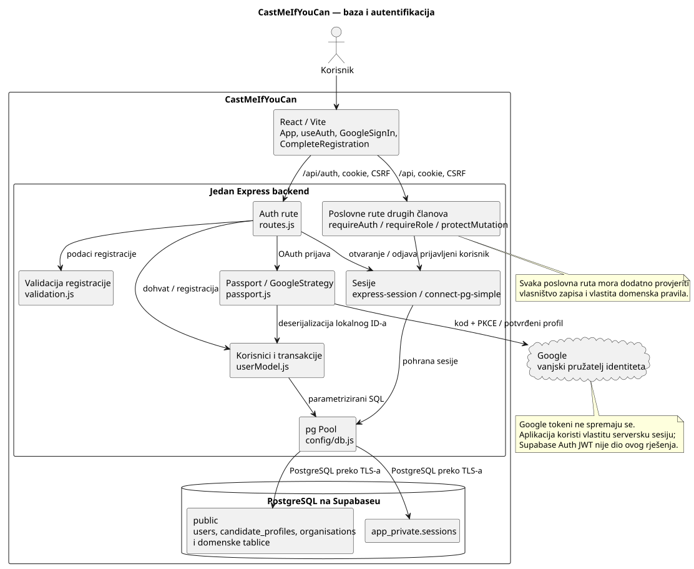
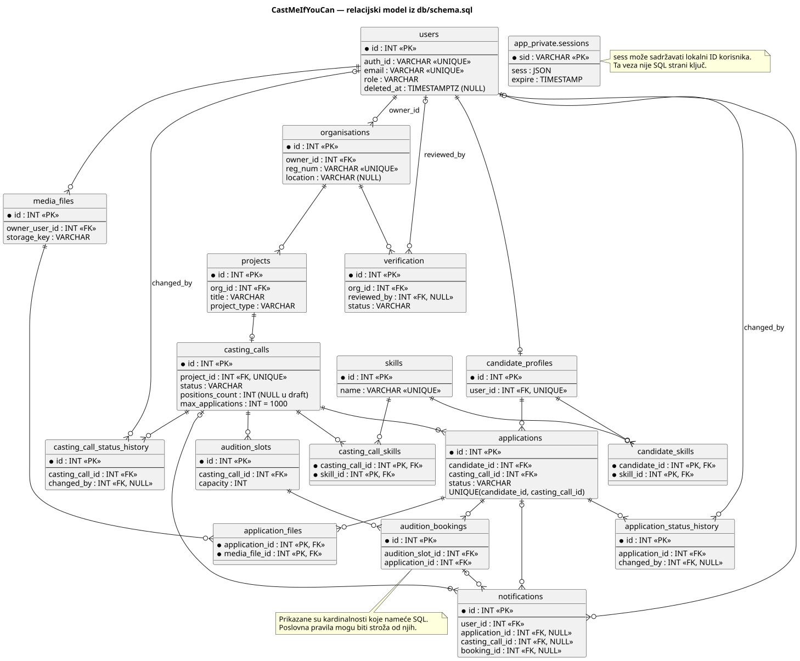
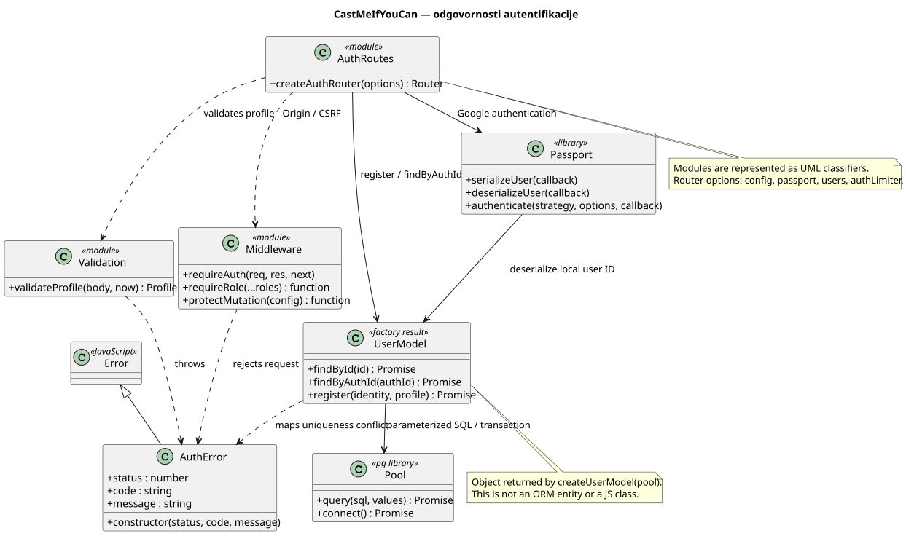
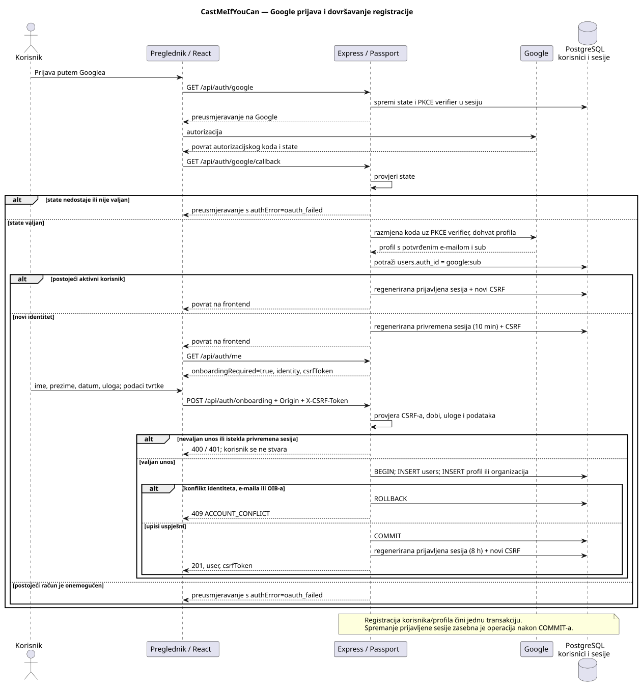

# 4. Arhitektura i oblikovanje — CastMeIfYouCan

**Stanje:** 17. 11. 2026., kod [bd785d4](https://github.com/paolabbradaric/grupa122/commit/bd785d4265b4a1ed35cfdd254f5f2f9e7c822a4d).

Poglavlje opisuje implementirane temelje baze i autentifikacije te njihove veze s ostatkom aplikacije. Poslovni moduli oglasa, prijava i audicija drugih članova koriste isti Express proces i PostgreSQL. Granice provjerenog ponašanja navedene su u [Ispitivanju](5-Ispitivanje.md).

## 4.1 Ključne arhitekturne odluke

| Odluka | Projektno obrazloženje i kompromis |
| --- | --- |
| Zadržati Express/CommonJS i postojeći pg pool | Prilagođen je auth pristup iz ranijeg NestJS projekta, bez uvođenja NestJS-a i TypeORM-a u postojeći backend. Moduli imaju zasebne odgovornosti unutar jednog procesa. |
| Identitet povezati preko `users.auth_id = google:` | Stabilni identitet određuje postojeći račun. Jednaki e-mail različitih identiteta ne pokreće automatsko povezivanje; konflikt se odbija. |
| Odvojiti vanjsku prijavu od lokalnih ovlasti | Google potvrđuje identitet, a baza određuje ulogu i aktivnost računa. Odabir uloge u pregledniku ne daje ovlasti. |
| Pohraniti serverske sesije u PostgreSQL | Sadržaj sesije nije u pregledniku i može se dohvatiti nakon restarta procesa. Prijava ovisi o dostupnosti baze; rate limiter i dalje ima memorijsku pohranu. |
| Korisnika i profil/tvrtku stvarati transakcijski | Konflikt ne ostavlja djelomično registriran račun. Otvaranje prijavljene sesije zasebna je operacija nakon registracijskog COMMIT-a. |
| Nacrte dodatno zaštititi DB ograničenjem | I izravni SQL odbija nepotpunu objavu. Backend i dalje provjerava vlasništvo, verifikaciju i dopuštene promjene statusa. |

## 4.2 Gradivni blokovi i UML dijagram komponenata

**PlantUML:** [mario-arhitektura.puml](puml/mario-arhitektura.puml).

| Komponenta | Odgovornost i kod |
| --- | --- |
| React klijent | Prikaz prijave, registracije i serverske uloge: [App.jsx](../frontend/src/App.jsx), [useAuth.js](../frontend/src/services/useAuth.js). |
| Auth rute | OAuth, status korisnika, registracija, odjava i limiter: [routes.js](../backend/src/auth/routes.js). |
| Passport i sesije | Google strategija, povezivanje identiteta, serijalizacija i ponovno učitavanje korisnika: [passport.js](../backend/src/auth/passport.js), [app.js](../backend/src/app.js). |
| Validacija i korisnički model | Provjera profila, parametrizirani SQL i transakcija: [validation.js](../backend/src/auth/validation.js), [userModel.js](../backend/src/auth/userModel.js). |
| Zaštite ruta | Prijava, uloga, Origin i CSRF; vlasništvo provjerava poslovni modul: [middleware.js](../backend/src/auth/middleware.js). |
| PostgreSQL | Domenske tablice i privatne sesije, uz TLS vezu iz backenda: [schema.sql](../db/schema.sql), [db.js](../backend/src/config/db.js). |
| Google | Vanjski pružatelj identiteta; access/refresh tokeni ne spremaju se za kasniju uporabu. |

Supabase pruža bazu. Ovaj modul ne koristi Supabase Auth JWT niti privilegirani pristup bazi iz preglednika.

## 4.3 Model podataka i oblikovanje razreda

### 4.3.1 ER dijagram i model podataka

**PlantUML:** [mario-model-podataka.puml](puml/mario-model-podataka.puml). **Implementacija:** [schema.sql](../db/schema.sql). Objašnjenje tablica, ograničenja i nadogradnji: [Baza podataka](BAZA_PODATAKA.md).

Shema ima 17 domenskih tablica i privatnu tablicu sesija. Temeljne veze su korisnik → kandidat/organizacija, organizacija → projekti → oglasi, kandidat + oglas → prijava te prijava + termin → rezervacija. Vezne tablice povezuju vještine i datoteke.

Dijagram prikazuje SQL kardinalnosti: korisnik ima najviše jedan kandidatov profil; vlasnik može imati više organizacija; projekt ima najviše jedan oglas. ID korisnika u JSON-u sesije nije strani ključ. Početni [ERDPlus model](../db/cast_me_if_you_can.erdplus) povijesni je izvor; aktualni prikaz uključuje kasnije migracije.

### 4.3.2 Reprezentativni UML dijagram razreda

**PlantUML:** [mario-auth-razredi.puml](puml/mario-auth-razredi.puml). **Kod:** [auth/](../backend/src/auth/).

Implementacija kombinira funkcije, objekte dobivene tvornicama i stvarne razrede. Stereotipovi to razlikuju: AuthError je razred, UserModel je objekt koji vraća createUserModel(pool), a router i validacija su moduli. Ne uvodi se izmišljeni ORM entitet. Ovo je prikaz sadašnje strukture, a ne dokaz da je dijagram izrađen prije koda.

## 4.4 Ponašanje tijekom izvođenja

### 4.4.1 Sekvencijski dijagram prijave i registracije

**Scenariji:** [UC-001 i UC-002](3-Obrasci-uporabe.md); F-001–F-005.

**PlantUML:** [mario-google-registracija.puml](puml/mario-google-registracija.puml).

Novi identitet prvo dobiva privremenu sesiju bez poslovnih ovlasti. Valjani registracijski podaci stvaraju lokalnog korisnika i profil/tvrtku. Pogrešan state odbija se prije razmjene tokena, a konflikt jedinstvenosti poništava cijeli registracijski upis. Passport regenerira sesiju i ona se izričito sprema prije odgovora. Registracija i upis prijavljene sesije nisu jedna zajednička DB transakcija.

### 4.4.2 Dijagram stanja korisničke prijave

**PlantUML:** [mario-auth-stanja.puml](puml/mario-auth-stanja.puml).

Vlasnik stanja je korisnikova prijava u aplikaciju. Stanje određuju aktivni korisnik učitan Passportom i/ili važeći pendingIdentity u sesiji. Gost, privremeni identitet i prijavljeni korisnik imaju različita prava. Cookie bez važeće serverske sesije ne znači prijavu. Deaktivacija korisnika onemogućuje pristup pri sljedećoj deserijalizaciji.

## 4.5 Zapisi arhitekturnih odluka

Zapisi su sastavljeni naknadno prema implementaciji, ranijoj dokumentaciji i PR-ovima.

### ADR-AUTH-01: Lokalna sesija nakon Google prijave

| Polje | Zapis |
| --- | --- |
| Kontekst | F-001–F-005 traže vanjsku prijavu, povezivanje profila i lokalne uloge; backend već koristi Express i PostgreSQL. |
| Izvor | [Razvojni plan](RAZVOJNI_PLAN.md), [PR #29](https://github.com/paolabbradaric/grupa122/pull/29). |
| Razmatrana prilagodba | Prenijeti NestJS/TypeORM podsustav ili potrebne odgovornosti prilagoditi postojećem backendu. |
| Odluka | Passport, stabilni Google identitet i serverska sesija uz parametrizirani SQL preko pg poola. |
| Posljedice | Nema vlastitih korisničkih lozinki ni njihove promjene. Lokalna autorizacija i održavanje privatne pohrane ostaju obveza aplikacije. |
| Status | Implementirano i spojeno; stvarni Google tok nije potvrđen zapisnikom od 17. 11. 2026. |

### ADR-DB-01: Nadogradnja postojeće baze migracijama

| Polje | Zapis |
| --- | --- |
| Kontekst | Pri ponovnom razvoju aplikacije postojeća baza je sačuvana; potrebni su limit, sesije i nepotpuni nacrti. |
| Izvor | [Razvojni plan](RAZVOJNI_PLAN.md), PR-ovi [#23](https://github.com/paolabbradaric/grupa122/pull/23), [#25](https://github.com/paolabbradaric/grupa122/pull/25), [#31](https://github.com/paolabbradaric/grupa122/pull/31). |
| Odluka | schema.sql za novu bazu, zasebne migracije za postojeću, uz provjeru početnog stanja. |
| Posljedice | Migracija limita nije ponovljiva; nevaljani postojeći nenacrti zaustavljaju nadogradnju nacrta. |
| Status | Implementirano. Ponovljivost i rollback draft migracije provjereni su na privremenim tablicama. |

## 4.6 Zajednička pravila oblikovanja

| Aspekt | Mehanizam i granica |
| --- | --- |
| Autorizacija | requireAuth/requireRole rade na backendu; poslovni modul dodatno provjerava vlasništvo i dopuštenu radnju. |
| Promjene | Auth POST rute i rute s protectMutation traže dopušteni Origin i CSRF; callback štiti state. |
| Validacija | Backend provjerava ulogu, datum, dob i OIB, a baza reference, jedinstvenost i numerička pravila. |
| Pohrana | Parametrizirani SQL i transakcije; updated_at i tablice povijesti nemaju opći automatski trigger. |
| Povjerljivost | HttpOnly cookie, Secure u produkciji; tajne i privatna shema nisu dostupni klijentu. |
| Pogreške | AuthError daje status, šifru i poruku; opći handler skriva SQL i interne detalje. |
| Pokušaji prijave | Zajedničkih 20 zahtjeva po IP-u u 15 minuta za početak prijave, callback i onboarding; limiter je memorijski. |

[Razmještaj i instalacija](6-Postavljanje-instalacija-i-konfiguracija.md) · [Auth API](AUTENTIFIKACIJA.md) · [Kazalo](Home.md)
