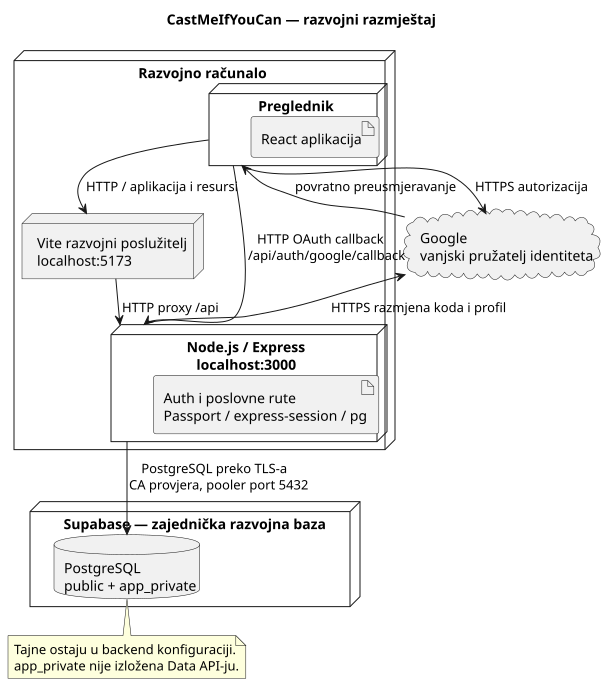

# 6. Postavljanje, instalacija i konfiguracija

Provjereno okruženje: Windows, Node.js 24.14.0 i npm 11.9.0; početna provjera na kodu `bd785d4`, 17. 11. 2026. Google upute uključuju naknadne promjene iz [PR-a #44](https://github.com/paolabbradaric/grupa122/pull/44), spojenog u `f42e73d`. PostgreSQL je dostupan preko zajedničke Supabase veze. Točne inačice paketa određuju lockfileovi u backend/ i frontend/.

Ovdje su razvojne upute za bazu i autentifikaciju. Javni URL i produkcijski razmještaj nisu potvrđeni ovim zapisom.

## 6.1 Prikaz razmještaja



PlantUML: [mario-razvojni-razmjestaj.puml](puml/mario-razvojni-razmjestaj.puml).

Preglednik otvara Vite na http://localhost:5173; proxy prosljeđuje /api Expressu na portu 3000. Google autorizacija koristi vanjsku HTTPS uslugu, a razvojni callback dolazi na backend. Veza prema Supabaseu koristi TLS i CA provjeru. Lokalni HTTP vrijedi za opisano razvojno okruženje.

## 6.2 Lokalna instalacija i konfiguracija

### Preduvjeti i paketi

Potrebni su Git, Node.js/npm, dostupna PostgreSQL baza i serverski pristupni podaci. Za stvarnu prijavu potreban je Google OAuth klijent. Za SQL se može koristiti psql ili drugi pouzdani PostgreSQL alat. Java/PlantUML potreban je samo za izradu dijagrama.

```powershell
git clone https://github.com/paolabbradaric/grupa122.git
cd grupa122
cd backend
npm ci
Copy-Item .env.example .env
```

Kopiranje je za novu konfiguraciju; postojeću .env datoteku urediti bez prepisivanja. Tajne se ne dodaju u Git. U drugom terminalu, iz korijena repozitorija:

```powershell
cd frontend
npm ci
```

### Varijable backenda

Vrijednosti su u backend/.env; [primjer](../backend/.env.example) ne sadrži lozinke. Backend konfiguraciju učitava neovisno o radnom direktoriju.

Postavka PGHOST, PGPORT, PGDATABASE, PGUSER, PGPASSWORD određuje sljedeće: PostgreSQL veza; zajednička adresa je u primjeru, lozinka se pribavlja sigurnim kanalom od vlasnika projekta.

Postavka PGSSL određuje sljedeće: true za zajedničku Supabase vezu; false samo za odgovarajuću lokalnu vezu bez TLS-a.

Postavka PGSSLROOTCERT određuje sljedeće: certs/supabase-ca.crt, relativno prema backend/. Provjera certifikata ostaje uključena.

Postavka PORT određuje sljedeće: 3000; pri promjeni uskladiti Vite proxy i callback.

Postavka NODE_ENV određuje sljedeće: development lokalno; production uključuje Secure cookie i zahtijeva HTTPS auth URL-ove.

Postavka FRONTEND_URL određuje sljedeće: http://localhost:5173.

Postavka GOOGLE_CALLBACK_URL određuje sljedeće: http://localhost:3000/api/auth/google/callback.

Postavka GOOGLE_CLIENT_ID, GOOGLE_CLIENT_SECRET određuje sljedeće: OAuth klijent ovog projekta.

Postavka ADMIN_EMAILS određuje potpune Google adrese pet administratora, odvojene zarezom. Popis se postavlja samo na backendu, privatno za svako okruženje. Primjer sintakse je `admin.one@example.com,admin.two@example.com`; stvarne adrese pribaviti od održavatelja. Normaliziraju se samo rubni razmaci i veličina slova. Prazan popis onemogućuje admin pristup, neispravna stavka zaustavlja pokretanje. Nakon promjene popisa restartati sve backend instance. Uklonjena adresa tada gubi pristup već na sljedećem admin zahtjevu postojeće sesije. Vidjeti [admin pristup](ADMIN_PRISTUP.md).

Postavka SESSION_SECRET određuje sljedeće: Zasebna nasumična tajna s najmanje 32 znaka; bez nje backend odbija pokretanje.

Postavka TRUST_PROXY_HOPS određuje sljedeće: Lokalno 0, drugdje stvaran broj pouzdanih proxy poslužitelja.

Generirati lokalnu sesijsku tajnu i pohraniti je u privatnu konfiguraciju:

```powershell
node -e "console.log(require('node:crypto').randomBytes(48).toString('hex'))"
```

### Nova i postojeća baza

Za novu praznu bazu, iz korijena repozitorija:

```powershell
psql -v ON_ERROR_STOP=1 -f db/schema.sql
```

Naredba pretpostavlja da je psql sigurno konfiguriran za namjeravanu bazu; psql sam ne učitava backend/.env. Node skripte koriste tu datoteku. Ne stavljati lozinku u verzioniranu naredbu.

Za postojeću bazu prvo utvrditi primijenjene promjene i slijediti [migracijski put](BAZA_PODATAKA.md#migracijski-put). Ne ponavljati inicijalizacijsku shemu nad zajedničkim podacima. Iz backend/ dostupne su zasebne nadogradnje:

```powershell
npm run db:migrate:auth
npm run db:migrate:casting-drafts
npm run db:migrate:admin
```

Ovo nisu obavezne naredbe svakog pokretanja. Draft migracija ima preduvjete, a starija migracija limita nije ponovljiva. Sesijska tablica mora postojati prije prijave jer aplikacija ne stvara tablicu automatski.

Admin migracija mijenja samo `users`: nepoznat datum rođenja, ime i prezime dopušteni su samo ulozi admin, a normalizirana adresa mora biti jedinstvena. Ne stvara račune niti mijenja njihove subjecte, profile i odluke verifikacije. Postojeće sukobljene adrese sigurno zaustavljaju cijelu transakciju; ne čistiti ih automatski. Nove instalacije koriste ažurirani `db/schema.sql`.

Frontend putanja `/admin` mora pri izravnom otvaranju i osvježavanju dobiti SPA `index.html`; `/api` mora ostati usmjeren na Express. Vite razvojni server to podržava. Na statičkom hostingu postaviti odgovarajući SPA fallback, a na nginxu nakon odvojene `/api` lokacije koristiti `try_files $uri $uri/ /index.html`. Produkcijski hosting nije konfiguriran ovim zadatkom. Dostupnost SPA ljuske ne daje ovlasti nad zaštićenim API-jem.

### Google OAuth

Pripremiti Google OAuth klijent vrste Web application i consent screen. U autorizirane redirect URI-je upisati točan GOOGLE_CALLBACK_URL. Publiku, osnovne scopes i pravila načina Testing provjeriti prema [Google prijavi — postavljanje i provjera](GOOGLE_PRIJAVA.md). Ključevi ostaju u privatnoj konfiguraciji backenda. Za postojeći lokalni klijent postupak i potvrđeno stanje opisani su u toj dopuni.

Bez ključeva OAuth navigacija preglednika na `GET /api/auth/google` ili callback dobiva `302` na frontend s `authError=google_not_configured`. JSON API zahtjev zadržava `503 GOOGLE_NOT_CONFIGURED`. Pri ograničenju pokušaja OAuth navigacija dobiva `302` s `authError=rate_limited`, a JSON API i onboarding zadržavaju `429 AUTH_RATE_LIMITED`; `Retry-After` ostaje dostupan. Frontend prikazuje odgovarajuću poruku i uklanja parametar iz URL-a. Nijedan od tih neuspjeha ne otvara prijavljenu sesiju; javni dio može raditi ako su baza i ostala konfiguracija dostupni.

Početni [zapisnik na reviziji bd785d4](verification/2026-11-17/README.md) nije uključivao stvarni Google ulazak. Naknadna [Google provjera](GOOGLE_PRIJAVA.md#stanje-provjere-17-11-2026) potvrđuje lokalni kandidatski tok: registraciju, ponovnu prijavu, osvježavanje i odjavu. Stvarni poslodavački tok, restart s postojećom prijavom i produkcijsko postavljanje nisu potvrđeni tim scenarijima.

### Pokretanje i osnovna provjera

U terminalu za backend iz korijena repozitorija:

```powershell
cd backend
npm start
```

U drugom terminalu iz korijena repozitorija:

```powershell
cd frontend
npm run dev
```

Otvoriti http://localhost:5173. Vite koristi fiksni port i strictPort: true. Ako je zauzet, osloboditi ga ili svjesno uskladiti sve povezane postavke. Dosljedno koristiti localhost, bez miješanja s 127.0.0.1.

Gost za GET /api/auth/me dobiva 401; nakon vanjske prijave endpoint vraća korisnika ili podatke za dovršavanje registracije. Auth POST zahtjevi trebaju svježi CSRF token iz /me i dopušteni Origin. Javni oglasi dohvaćaju se preko /api/castings; prazan rezultat može značiti nedostatak odgovarajućih objavljenih podataka.

Provjere iz backend/:

```powershell
npm test
node --test test/auth.test.js
npm run test:db
npm run test:db:casting
```

Provjere iz frontend/:

```powershell
npm run lint
npm run build
```

Auth/draft DB provjere koriste privremene tablice konfigurirane veze. Pojedini testovi drugih modula traže zasebnu lokalnu bazu i eksplicitne zastavice; [Ispitivanje](5-Ispitivanje.md) razlikuje te rezultate.

### Kontrole poslovnih upisa

Za postavke APPLICATION_WRITES_ENABLED, APPLICATION_WRITES_CONFIRMED vrijedi sljedeće: Zadano false; za upise prijava obje trebaju biti true.

Za postavke APPLICATION_WRITES_ALLOW_REMOTE vrijedi sljedeće: Dodatni uvjet za upise prijava izvan lokalnog castme_test; nije potreban za privremene auth/draft testove.

Za postavke EMPLOYER_CASTING_WRITES_ENABLED, EMPLOYER_CASTING_WRITES_CONFIRMED vrijedi sljedeće: Zadano false; kod dopušta uključivanje samo za localhost/127.0.0.1, port 5432 i bazu castme_test.

Ove postavke nisu globalna zabrana svih upisa. Registracija i sesije imaju vlastite upise, a druge rute treba provjeriti prema njihovu kodu. Ne uključivati poslovne upise u zajedničkoj bazi samo radi demonstracije instalacije.

## 6.3 Javno postavljanje i administracija

Javni URL aplikacije i produkcijska provjera nisu potvrđeni ovim doprinosom. Udaljena baza sama ne dokazuje javno postavljenu web aplikaciju.

Prije produkcije treba pripremiti HTTPS frontend/backend, točan Google callback, zasebnu tajnu, pouzdanu proxy topologiju i /api na istoj domeni. Cookie tada ima Secure i SameSite=Lax. Za više instanci potreban je zajednički limiter; sesijski store već je izvan memorije procesa.

Vlasnik baze treba odrediti aplikacijski račun s manjim pravima, povratne kopije i postupak obnove. app_private se ne izlaže Data API-ju. Produkcijska objava, migracije i promjene prava nisu provedene ovom dokumentacijskom dopunom.

## 6.4 Česte konfiguracijske pogreške

Ako se pojavi problem „backend odbija pokretanje zbog tajne”, treba napraviti sljedeću provjeru: SESSION_SECRET mora postojati i imati najmanje 32 znaka.

Ako se pri Google prijavi preglednik vrati s porukom da prijava nije dostupna (`authError=google_not_configured`) ili JSON API vrati `503 GOOGLE_NOT_CONFIGURED`, provjeriti oba OAuth ključa u privatnoj konfiguraciji i restartati backend nakon izmjene.

Ako se preglednik vrati s `authError=rate_limited` ili JSON API vrati `429 AUTH_RATE_LIMITED`, pričekati vrijeme iz `Retry-After` prije novog pokušaja.

Ako se pojavi problem „google odbija callback”, treba napraviti sljedeću provjeru: Usporediti protokol, host, port i punu putanju redirect URI-ja.

Ako se pojavi problem „pOST vraća 403”, treba napraviti sljedeću provjeru: Provjeriti sesiju, svježi CSRF token i Origin; ne miješati lokalne hostove.

Ako se pojavi problem „tLS veza ne prolazi”, treba napraviti sljedeću provjeru: Provjeriti adresu, dostupnost i CA putanju; ne gasiti provjeru certifikata kao zamjenu za ispravnu konfiguraciju.

Ako se pojavi problem „sesijska tablica ne postoji”, treba napraviti sljedeću provjeru: Provjeriti shemu i auth migraciju prije prijave.

Ako se pojavi problem „poslovni upis odbijen iako prijava radi”, treba napraviti sljedeću provjeru: Provjeriti zastavice i dopuštenu ciljnu bazu; autentifikacija i poslovni upisi odvojeni su mehanizmi.

[Autentifikacija](AUTENTIFIKACIJA.md), [Baza](BAZA_PODATAKA.md), [Kazalo](Home.md)
