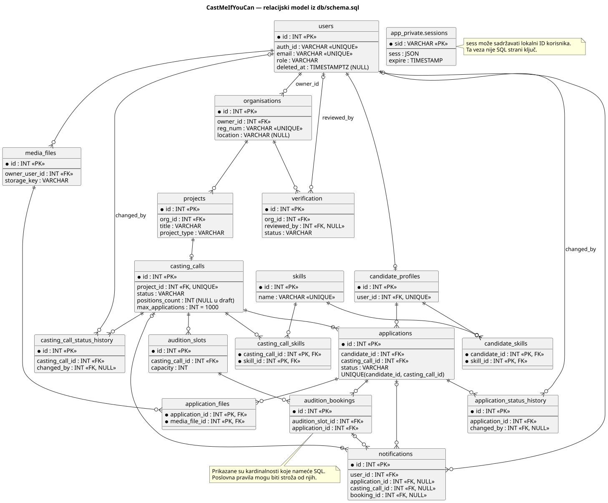

# Baza podataka — model, migracije i povezivanje

**Područje:** Mario Halužan, [zadatak #12](https://github.com/paolabbradaric/grupa122/issues/12). **Provjera:** 17. 11. 2026., revizija bd785d4.

PostgreSQL pohranjuje korisnike i domenske podatke. Supabase pruža zajedničku bazu, kojoj Express pristupa preko pg poola. [schema.sql](../db/schema.sql) je mjerodavan izvor stupaca, tipova, zadanih vrijednosti i ograničenja.

## Model i identiteti

**PlantUML:** [izvor](puml/mario-model-podataka.puml). Početni [ERDPlus model](../db/cast_me_if_you_can.erdplus) i SQL dodani su 17. 10. 2026.; prikaz uključuje naknadne migracije.

Shema ima 17 domenskih tablica i privatnu tablicu sesija. Domenske tablice uglavnom koriste INT identitetni primarni ključ; vezne tablice složene ključeve. Domenska vremena koriste TIMESTAMPTZ, a datum rođenja DATE.

| Tablica | Podaci i veze |
| --- | --- |
| users | Jedinstveni auth_id i email, ime, prezime, datum rođenja, uloga, vremena i neobavezni deleted_at. Google identitet je `google:`; nema korisničke lozinke. |
| candidate_profiles | Biografija, iskustvo, grad, država, visina i video; jedinstveni user_id daje najviše jedan profil po korisniku. |
| organisations | Naziv, jedinstveni reg_num (OIB), kontakt, telefon, web i sjedište; owner_id upućuje na korisnika. SQL dopušta više organizacija po vlasniku; registracija stvara jednu. |
| projects | Naziv, vrsta, opis i datumi; org_id upućuje na organizaciju. |
| casting_calls | Uloga, broj mjesta, limit prijava, tekst audicije, dobni i drugi uvjeti, lokacija, rok i status; jedinstveni project_id daje najviše jedan oglas po projektu. |
| applications | Kandidat, oglas, motivacijsko pismo, video, status i razlog odbijanja; jedinstveni par (candidate_id, casting_call_id). |
| audition_slots | Oglas, početak/kraj, lokacija, kapacitet i status termina. |
| audition_bookings | Veza termina i prijave, status rezervacije/dolaska i vremena rezervacije/otkazivanja. |
| notifications | Korisnik, vrsta, naslov, poruka, pročitano i vrijeme e-pošte; neobavezne veze na prijavu, oglas i rezervaciju. |
| media_files | Vlasnik, vrsta, ključ pohrane, naziv, MIME tip i veličina; sadržaj datoteke nije u tablici. |
| verification | Organizacija, status zahtjeva, vremena podnošenja/pregleda, razlog odbijanja i neobavezni pregledavatelj. |
| skills | Jedinstveni naziv i neobavezna kategorija vještine. |
| candidate_skills | Složeni ključ kandidata i vještine, uz razinu znanja. |
| casting_call_skills | Složeni ključ oglasa i vještine. |
| application_files | Složeni ključ prijave i medijske datoteke, uz vrstu priloga. |
| casting_call_status_history | Oglas, stari/novi status, razlog, vrijeme i neobavezni autor promjene. |
| application_status_history | Prijava, stari/novi status, razlog, vrijeme i neobavezni autor promjene. |
| app_private.sessions | Primarni ključ sid, JSON sess i vrijeme isteka expire, s indeksom isteka. ID korisnika u JSON-u nije SQL strani ključ. |

Strani ključevi ne deklariraju ON DELETE CASCADE. Trajno brisanje zahtijeva poslovni postupak. Tablice same ne implementiraju obavijesti, upload, verifikaciju ni rezervacije. Povijest i updated_at nemaju opći automatski trigger. Uloge i statusi su tekstualni stupci bez potpunog SQL skupa dopuštenih vrijednosti.

## Integritet i pravila oglasa

positions_count označava koliko se kandidata traži, a max_applications koliko je prijava najviše dopušteno. Zadani limit je 1000: pet mjesta može primiti tisuću prijava. DB stupac ne broji prijave samostalno i ne zamjenjuje zaštitu od automatiziranih pokušaja.

| Ograničenje | Značenje |
| --- | --- |
| profile_user_unique | Najviše jedan kandidatov profil po korisniku. |
| application_unique | Najviše jedna prijava istog kandidata na isti oglas. |
| project_unique | Najviše jedan oglas po projektu. |
| positions_positive, max_applications_positive | Uneseni broj mjesta i limit prijava moraju biti pozitivni. |
| age_range | Svaka unesena dob najmanje 18; ako su unesene obje, max_age >= min_age. |
| slot_capacity_positive, slot_time_range | Pozitivan kapacitet i kraj termina nakon početka. |
| casting_calls_complete_unless_draft | Samo draft dopušta nepotpuna sadržajna polja oglasa. |

| Podatak | draft | Svaki drugi status |
| --- | --- | --- |
| title, description, location | Smiju nedostajati ili biti prazni. | Obavezni; sam razmak, tabulator ili novi red nije sadržaj. |
| positions_count | Smije biti NULL; uneseni broj mora biti pozitivan. | Obavezan pozitivan cijeli broj. |
| min_age, max_age | Smiju neovisno nedostajati; unesene vrijednosti moraju zadovoljiti raspon. | Obje obavezne i najmanje 18; najveća nije manja od najmanje. |
| application_deadline | Smije biti NULL. | Obavezan. |
| max_applications | Obavezan pozitivan, zadano 1000. | Isto. |
| project_id, status | Obavezni; projekt mora postojati. | Isto. |

Potpunost vrijedi za INSERT i UPDATE te published, closed, filled i cancelled: iznimku ima samo draft. Povreda daje SQLSTATE 23514 i naziv ograničenja, koji API treba prevesti u razumljivu poruku. Nedostajuće brojeve i datum slati kao NULL, ne kao prazan niz ili izmišljenu vrijednost.

Projekt povezan s nacrtom i dalje zahtijeva title, project_type i org_id. Budući rok, vlasništvo, verifikacija i prijelazi statusa provjeravaju se u backendu. Rok u budućnosti nije trajni CHECK uvjet jer oglasi prirodno isteknu.

## Migracijski put

| Polazno stanje | Postupak |
| --- | --- |
| Nova prazna baza | Izvršiti cijeli db/schema.sql. Struktura već uključuje limit, auth i nacrte; ne ponavljati staru migraciju limita. |
| Početna shema prije limita | Jednom primijeniti casting_call_maxapp.sql, zatim potrebnu auth i draft migraciju. |
| Shema bez auth dijela | npm run db:migrate:auth iz backend/. |
| Shema s limitom, ali svim sadržajnim poljima obaveznima | Provjeriti nenacrte i primijeniti npm run db:migrate:casting-drafts. |
| Aktualna shema | Ne ponavljati inicijalizaciju. Auth skripta može se ponoviti za izričito usklađivanje prava Supabase uloga ako postoje. |

1. [casting_call_maxapp.sql](../db/migrations/casting_call_maxapp.sql) dodaje limit, pozitivnost i jedinstveni projekt te preimenuje šest ograničenja. Transakcijska je, ali **nije idempotentna**: očekuje staru shemu i nazive.
2. [auth_sessions.sql](../db/migrations/auth_sessions.sql) dodaje sesije i indeks isteka, sjedište, indeks vlasnika i zaštite auth tablica. [migrate-auth.js](../backend/scripts/migrate-auth.js) omata SQL u transakciju; nad očekivanom strukturom promjena je ponovljiva.
3. [20261104205039_casting_call_drafts.sql](../db/migrations/20261104205039_casting_call_drafts.sql) mijenja obaveznost polja i CHECK uvjete. Ima vlastitu transakciju i lock_timeout od pet sekundi; očekuje prethodna ograničenja i može se ponoviti.

Preduvjeti i upit za neispravne nenacrte nalaze se u [db/Readme.md](../db/Readme.md). Nevaljani postojeći podaci poništavaju draft migraciju bez izmišljanja sadržaja i mijenjanja statusa. Migracije nisu automatski dio npm start. Prije nadogradnje potvrditi ciljnu bazu i osigurati povratnu kopiju prema postupku vlasnika baze. Ovom dokumentacijskom dopunom trajne tablice nisu migrirane.

## Povezivanje i privatnost

[db.js](../backend/src/config/db.js) učitava backend/.env: PGHOST, PGPORT, PGDATABASE, PGUSER i PGPASSWORD. Uz PGSSL=true koristi rejectUnauthorized=true; CA se čita iz PGSSLROOTCERT relativno prema backend/. Zajednički primjer koristi Supabase pooler na portu 5432 i javni [CA certifikat](../backend/certs/supabase-ca.crt). Lokalna veza bez TLS-a može koristiti PGSSL=false.

Auth migracija uključuje RLS na users, candidate_profiles, organisations i app_private.sessions, povlači PUBLIC pristup privatnoj shemi/sesijama te izričito povlači auth prava ulogama anon i authenticated ako postoje. To ne predstavlja potpunu RLS zaštitu svih domenskih tablica. Backend koristi privilegiranu PG vezu i provodi autorizaciju u Expressu; zaseban račun s manjim pravima ostaje otvorena stavka.

app_private ne smije biti izložena Supabase Data API-ju. Lokalni cjelobrojni korisnički ID i Express sesija ne koriste Supabase auth.uid() kao identitet korisnika. Lozinke, sesijske tajne i privilegirani ključevi ostaju izvan frontenda i Gita.

## Dokazi i ograničenja

Početni model: [dfc3527](https://github.com/paolabbradaric/grupa122/commit/dfc3527) i [2db2a8f](https://github.com/paolabbradaric/grupa122/commit/2db2a8f). Nadogradnje: PR-ovi [#23](https://github.com/paolabbradaric/grupa122/pull/23), [#25](https://github.com/paolabbradaric/grupa122/pull/25), [#29](https://github.com/paolabbradaric/grupa122/pull/29) i [#31](https://github.com/paolabbradaric/grupa122/pull/31).

Dana 17. 11. 2026. auth DB i draft provjere pokrenute su na konfiguriranom PostgreSQL-u, uz privremene tablice. Provjeravaju registraciju, rollback konflikta, sesijski store, pravila nacrta, podudaranje sheme i migracije, očuvanje testnih redaka i povrat neuspjele migracije. To nije produkcijsko ispitivanje ni ponovno izvođenje trajnih migracija. [Zapisnik](verification/2026-11-17/README.md) navodi rezultate.

[Instalacija](6-Postavljanje-instalacija-i-konfiguracija.md) · [Autentifikacija](AUTENTIFIKACIJA.md) · [Kazalo](Home.md)
